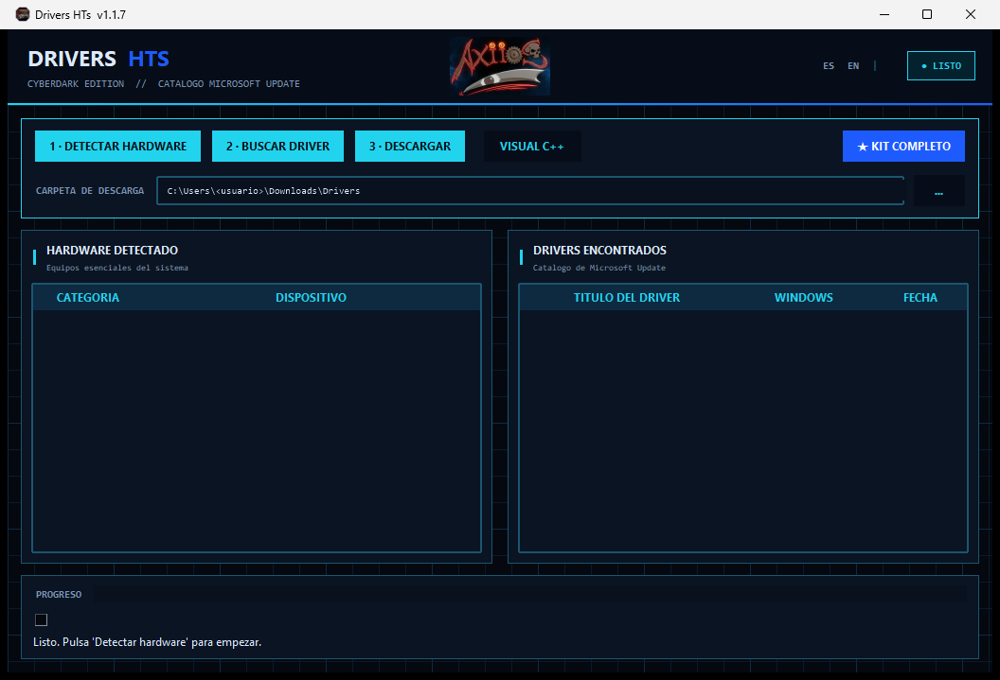

# Drivers HTs

Descarga e instala drivers esenciales tras formatear Windows 10/11 desde el [Catálogo de Microsoft Update](https://www.catalog.update.microsoft.com/).

## Descarga

Descarga desde [Releases](https://github.com/SaeHTs/Drivers-HTs/releases):
- **DriversHTs-Setup.exe** — Instalador (recomendado). Crea accesos directos.
- **DriversHTs.zip** — Portable. Ejecuta sin instalar.

## Características

- **Detección automática** — Red, GPU, audio y chipset
- **Drivers oficiales** — Desde el catálogo de Microsoft Update
- **★ RECOMENDADO** — Selecciona el mejor driver para tu Windows
- **Kit completo** — Descarga e instala todo con un clic
- **Visual C++ Redistributables** — 2005-2022 x86/x64
- **Instalación directa** — `.cab`/`.zip` con `pnputil`, `.msu` con `wusa.exe`
- **Bilingüe** — Español/Inglés (se adapta a Windows)
- **Instalador por usuario** — Sin permisos de administrador

## Uso

1. Ejecuta la app
2. Selecciona los drivers que necesitas o usa "Kit completo"
3. Descarga e instala

*Requiere ejecutar como administrador para instalar drivers.*

## Capturas

  

## Licencia

MIT - ver [LICENSE](LICENSE).
